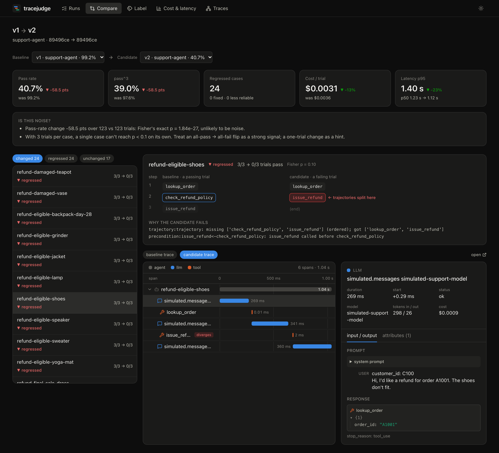
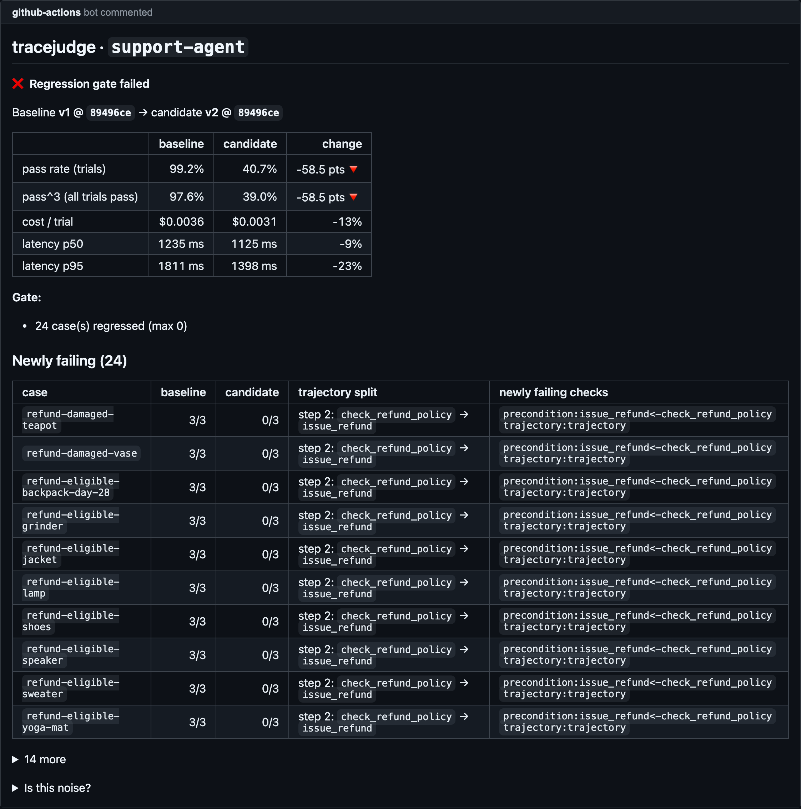
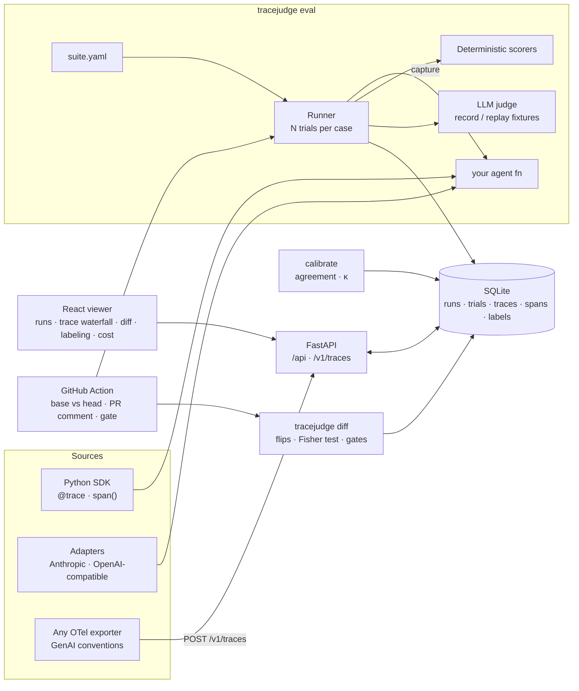

# tracejudge

**Agent regressions hide in the trajectory, not the answer.** A prompt tweak can make a support agent refund orders without checking the refund policy. The customer still gets a polite "I've refunded $149", the latency even improves, and an eval that only grades final answers stays green. tracejudge runs your tool-calling agent through a test suite several times per case, scores *what it did* as well as what it said, and in CI shows exactly which cases flipped and at which step the trajectory split.



<sub>Screens from `make demo` (sample runs bundled in `demo-data/`, no API key needed). More: [runs](docs/img/runs.png) · [trace waterfall](docs/img/trace.png) · [labeling](docs/img/label.png) · [cost & latency](docs/img/dashboard.png)</sub>

## What it does

- **Traces any agent.** A small Python SDK (`@trace`, `span()`), drop-in adapters for the Anthropic SDK and any OpenAI-compatible client, and an **OTLP/HTTP endpoint that understands the OpenTelemetry GenAI semantic conventions** (plus OpenInference), so traces from other frameworks plug in. Every span carries inputs, outputs, tokens, cost and latency.
- **Scores trajectories, not just answers.** Deterministic scorers for final answers, tool calls with argument matching (operators and JSON Schema), ordered/unordered/exact trajectories, forbidden actions, preconditions ("`issue_refund` must come after `check_refund_policy`") and step/token/cost budgets. Rubric-based **LLM-as-judge** with one structured verdict per criterion (default `claude-sonnet-5-5`).
- **Treats agents as non-deterministic.** Each case runs N times (default 3). Reports give pass@k, pass^k (every trial passes), flaky cases and a Wilson interval.
- **Calibrates the judge against humans.** A labeling screen (keyboard-driven, blind to the automated verdict) feeds per-criterion **agreement and Cohen's kappa**, with the confusion matrix split into "judge too lenient" and "judge too strict".
- **Gates PRs.** `tracejudge diff` and a reusable GitHub Action show per-case flips, cost and latency changes and a significance check. The Action posts one PR comment and fails past your thresholds. This repo's own CI runs it on every PR, with no API key.

## Results

The bundled demo is a customer-support agent with mock tools (look up an order, check the refund policy, refund, change an address, escalate) and policy rules, in the spirit of tau-bench's retail domain. The suite has 41 cases, each run 3 times. **v2** is a "make it friendlier" rewrite of v1's system prompt that, while condensing the policy section, drops *"always call check_refund_policy before issue_refund"*. **v3** keeps v2's tone and restores the rule.

`tracejudge eval examples/support_agent/suite.yaml`: 41 cases × 3 trials, agent on the **simulated model**.

| Agent | Pass rate | pass@3 | pass^3 | Flaky cases | LLM steps | Cost / trial* | Latency p50 / p95* |
|:--|--:|--:|--:|--:|--:|--:|--:|
| always-refuse (baseline, 1 trial) | 0.0% | – | – | 0 | 0.0 | $0 | – |
| v1 | 99.2% | 100.0% | 97.6% | 1 | 3.1 | $0.0036 | 1235 / 1811 ms |
| **v2 (regression)** | **40.7%** | **41.5%** | **39.0%** | 1 | 2.7 | $0.0031 | 1125 / 1398 ms |
| v3 (fix) | 99.2% | 100.0% | 97.6% | 1 | 3.1 | $0.0039 | 1238 / 1801 ms |
| claude-sonnet-5-5 (v1 / v2) | _pending_ | | | | | | |

\* **The agent rows run on a simulated model, not an LLM.** [`simulated.py`](examples/support_agent/simulated.py) is keyword logic that follows whatever rules the system prompt contains and makes seeded slips (6% "skip the lookup", 15% "terse confirmation"). It exists so the demo, the tests and CI need no API key. Its tokens are estimated at 4 characters per token and priced at claude-sonnet-5-5 rates; its latency is a simulated sleep. These rows show that **tracejudge catches the regression**. They say nothing about how good any model is.

> **TODO, needs an API key:** the Claude row. `SUPPORT_AGENT_MODEL=claude-sonnet-5-5 make eval-demo` fills it with real numbers. Nothing in this table is estimated or hand-entered: every row comes from the bundles in `demo-data/`.

What the v1 → v2 diff found: 24 of 41 cases regressed (3/3 → 0/3), Fisher's exact p = 1.8e-27 over 123 vs 123 trials. **10 of those 24 are refunds that *should* go through**, so the final answer ("I've refunded $129.00…") is correct. Only the `precondition` and `trajectory` scorers catch them, because v2 refunded without checking. v2 is also **13% cheaper and 23% faster at p95** because it skips a tool call, so a cost/latency dashboard alone would read the regression as an improvement. The always-refuse baseline scores 0%, which shows the suite can't be passed by declining everything.

### Catching a regression in 60 seconds

```bash
make demo   # builds the viewer, loads demo-data/, serves http://127.0.0.1:7600
```

1. **CI comment.** On a PR that changes the prompt, the Action runs the suite at the base commit and at the head and comments:

   

   <sub>This is the Action's real `report.md` for v1 → v2, rendered through GitHub's markdown API by `scripts/screenshots.py`. The workflow `regression-demo` reproduces it on GitHub Actions.</sub>

2. **Diff view.** Open *Compare → v1 → v2*. The Compare view shows the tiles (pass rate −58.5 pts, cost −13%), the noise check, and the 24 regressed cases. Pick `refund-eligible-shoes`: its answer is right, but the step list shows the baseline calling `check_refund_policy` at step 2 while the candidate goes straight to `issue_refund`.
3. **Trajectory divergence.** Below that, the candidate's trace waterfall marks the diverging span. Click the LLM span before it to read the exact prompt and response.

## Judge calibration

An LLM judge is only useful if it agrees with the people who'd otherwise grade the transcripts. tracejudge makes that a measured number, per criterion:

```bash
tracejudge label RUN          # or the Label screen: P pass · F fail · S skip · U undo · N note
tracejudge calibrate -d       # agreement, Cohen's kappa, confusion matrix, every disagreement
```

- Labeling is **blind**: the automated verdict is shown only *after* you label, so it can't anchor you.
- The queue is **stratified by judge verdict**. If the judge passes 95% of trials, a uniform sample would almost never test whether its failures are right.
- Agreement alone misleads. A judge that passes everything agrees 90% with humans who fail 1 trial in 10, yet its kappa is 0. Both are reported, plus "too lenient" vs "too strict" counts.
- Besides judge criteria you can label `overall` ("should this trial pass?") to check the suite's combined verdict, deterministic scorers included. This works without any API key.

The demo suite defines three judge criteria (`policy_compliance`, `grounded`, `helpful_tone`):

| Criterion | n labelled | Agreement | Cohen's κ | Rubric change that improved it |
|:--|--:|--:|--:|:--|
| policy_compliance | _pending_ | | | |
| grounded | _pending_ | | | |
| helpful_tone | _pending_ | | | |

> **TODO:** these rows need (1) judge verdicts, recorded once with an API key (`tracejudge eval … --record`, which writes `examples/support_agent/fixtures/judge/` so CI replays them), and (2) 50–100 human labels. Neither can be faked. The bundled runs have no judge verdicts, so their judge criteria show as *skipped*, never as passed.

## Architecture



## Quickstart

Requires Python 3.12, [uv](https://docs.astral.sh/uv/) and Node 24.

```bash
git clone https://github.com/nikolasss4/tracejudge && cd tracejudge
make demo                       # http://127.0.0.1:7600 with the sample runs
# or: docker compose up          # same thing in a container
```

Evaluate your own agent: it's any function `input -> output`. Wrap its tools with `@trace(kind="tool")`, or instrument its LLM client.

```python
# my_agent.py
import anthropic
from tracejudge import trace
from tracejudge.adapters import instrument_anthropic

client = instrument_anthropic(anthropic.Anthropic())  # every messages.create becomes an llm span


@trace(kind="tool")
def lookup_order(order_id: str) -> dict: ...


def run(
    inp: dict,
) -> str: ...  # your loop: client.messages.create(...), lookup_order(...), return the final answer
```

```yaml
# suite.yaml
name: my-agent
agent: my_agent:run
repeats: 3
cases:
  - id: refund-outside-window
    input: {customer_id: C100, message: "Refund A2001 please"}
    expect:
      forbidden: [issue_refund]
      tool_calls: [{name: check_refund_policy, args: {order_id: A2001}}]
      preconditions: {issue_refund: check_refund_policy}
      final_answer: {contains_any: ["can't", "cannot"]}
      budget: {max_steps: 6, max_cost_usd: 0.05}
```

```bash
tracejudge eval suite.yaml --label baseline
tracejudge eval suite.yaml --label candidate --agent my_agent:run_new
tracejudge diff baseline candidate --max-regressions 0 --markdown report.md
tracejudge serve                # viewer + API + OTLP endpoint on :7600
```

Already emitting OpenTelemetry? Point the exporter at the server:
`OTEL_EXPORTER_OTLP_TRACES_ENDPOINT=http://127.0.0.1:7600/v1/traces` (JSON works out of the box; protobuf needs `pip install "tracejudge[otlp]"`).

### In CI

```yaml
# .github/workflows/agent-eval.yml
on: pull_request
permissions: {contents: read, pull-requests: write}
jobs:
  eval:
    runs-on: ubuntu-latest
    steps:
      - uses: actions/checkout@v4
        with: {fetch-depth: 0}
      - uses: nikolasss4/tracejudge@main
        with:
          suite: evals/suite.yaml
          install: pip install -r requirements.txt
          max-regressions: "0"
          max-pass-rate-drop: "0.05"
          max-cost-increase: "0.25"
        env:
          ANTHROPIC_API_KEY: ${{ secrets.ANTHROPIC_API_KEY }}
```

The Action runs the suite at the PR's base commit (in a git worktree) and at the head, or compares against `baseline-agent:` in the same checkout. It updates a single PR comment, uploads both runs as an artifact (`tracejudge import runs.json.gz && tracejudge serve` to browse them) and fails when a gate is crossed.

## Reproduce the eval

```bash
make eval-demo                  # v1 and v2 on the simulated model, then the diff (no key)
make demo-data                  # regenerate demo-data/ (v1, v2, v3)
SUPPORT_AGENT_MODEL=claude-sonnet-5-5 ANTHROPIC_API_KEY=... make eval-demo   # real model
uv run tracejudge eval examples/support_agent/suite.yaml --record   # record judge fixtures
```

The simulated model is seeded (`SIM_SEED`, default 0), so its runs reproduce exactly. `SIM_LATENCY=0` makes it instant.

## Design decisions

- **Score the trajectory as data.** Tool calls are extracted from spans in start order, so the same scorers work on SDK traces and on OTLP traces from other frameworks. Preconditions ("Y before X") catch the most common agent safety failure, acting without checking, that answer-only grading can't see. ([ADR 0002](docs/adr/0002-otel-genai-mapping.md))
- **A regression is a majority flip, not a single trial.** With 3 trials per case, one flaky trial doesn't fail a PR but a behaviour that consistently breaks does. Every report says what the sample size can and can't show. ([ADR 0004](docs/adr/0004-regression-definition.md))
- **Skipped is not passed.** A judge criterion without a fixture or key is reported as skipped and excluded from the verdict. A tool that quietly defaults to "pass" would make the CI gate meaningless.
- **One structured judge call per trial.** All criteria are graded in one call, each with its own verdict and reasoning, using JSON-schema output, so verdicts parse reliably and cost stays flat as criteria grow.
- **Local-first: one SQLite file, JSON bundles to move runs.** No server to run, works the same on a laptop, in CI and in Docker. ([ADR 0001](docs/adr/0001-sqlite-local-first-storage.md))
- **Keyless CI by design.** A simulated model and request-hashed judge fixtures keep the dogfood pipeline deterministic, free and fork-safe. ([ADR 0003](docs/adr/0003-keyless-ci.md))

## How it compares

These are good tools and they overlap with tracejudge. The differences below are about emphasis, not a scorecard.

| | Where tracejudge differs |
|:--|:--|
| **Langfuse** | Langfuse is a full observability platform (tracing, prompt management, datasets, annotation queues, LLM-as-judge) that you self-host or use as a service. tracejudge is a single pip package plus a SQLite file, built around the PR gate, and it reports judge-vs-human kappa per criterion as a headline number. |
| **promptfoo** | promptfoo is also CLI- and CI-first with YAML configs, and goes much further on red-teaming and prompt comparison. tracejudge is centred on multi-step tool-calling agents: trajectory/precondition scorers, N trials with pass^k, a trace waterfall and a step-level divergence view. |
| **Braintrust** | Braintrust is a hosted platform with polished experiment diffs, scorers and human review. tracejudge runs entirely on your machine or CI runner, with no account, and its PR gate and comment are built in. |
| **LangSmith** | LangSmith is the hosted tracing/eval platform for the LangChain ecosystem, with datasets and annotation queues. tracejudge is framework-agnostic and ingests OpenTelemetry GenAI spans directly. |
| **Arize Phoenix** | Phoenix is open source, local and OpenTelemetry/OpenInference-native, with strong tracing and evals. tracejudge reads OpenInference spans too; it adds the regression workflow (base vs head runs, flips, gates, PR comment) and judge calibration. |

If you need production monitoring at scale, multi-user projects or a hosted UI, use one of the above. tracejudge targets the step before that: *did this PR make my agent worse?*

## Limitations

Things I observed or know are missing:

- **No real-model numbers yet.** The results above come from the simulated model; the Claude rows and the calibration table are empty until someone runs them with a key and labels trials.
- **The simulated model is too clean a regression.** v2 fails all of its refund cases 3/3. A real LLM given v2's prompt would likely be inconsistent (it often still checks the policy), which is exactly where repeats, pass^k and the "less reliable" bucket matter. That path is unit-tested but not yet shown on real data.
- **Judge fixtures are brittle by design.** Any change to the agent's transcript changes the request hash, so CI judge criteria fall back to *skipped* until fixtures are re-recorded. Deterministic scorers carry the gate in the meantime.
- **Per-case significance is weak.** With 3 trials, a single case can't reach p < 0.1. The run-level Fisher test is the real signal; per-case flips are evidence, not proof.
- **Streaming calls aren't auto-instrumented.** The Anthropic adapter wraps `messages.create`; for `messages.stream` use `span(kind="llm")` and `set_usage()`.
- **Single-user, local viewer.** No auth beyond binding to 127.0.0.1, refusing cross-origin writes and an optional OTLP bearer token. Don't expose it to the internet.
- **SQLite and in-Python aggregation** are fine for thousands of trials, not millions of production spans.

## Roadmap

- Record real Claude runs and judge fixtures; fill in the results and calibration tables.
- Importer for glassbox browser-agent traces (once that repo is public).
- Pairwise judge mode (A vs B on the same case) and position-bias checks.
- Auto-suggest rubric edits from calibration disagreements.
- Publish to PyPI (`pip install tracejudge`); the package already builds with the viewer bundled.

## Development

```bash
make install && make test && make lint   # 75 tests: ruff, mypy, pytest, oxlint
make dev                                 # API on :7600 + Vite with hot reload on :5173
```

## License

MIT, see [LICENSE](LICENSE).
